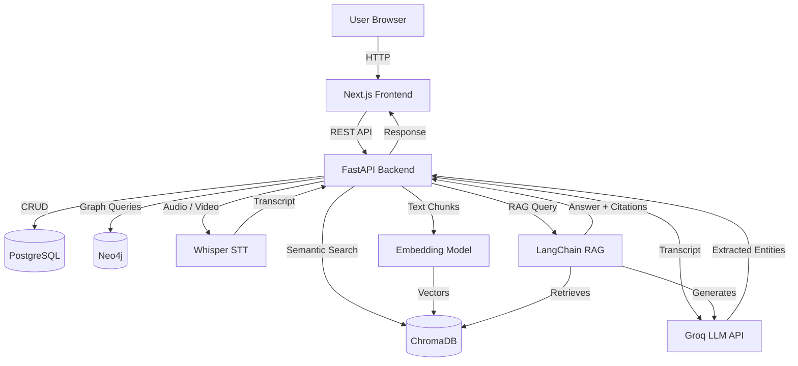

# SYSTEM ARCHITECTURE — LEGACYOS

> Human Knowledge Preservation System
> **Status: Planned Architecture — Day 1 Initialisation**

---

## 1. Architecture Overview

LEGACYOS follows a layered, service-oriented architecture. Each layer has a clear
responsibility and communicates with adjacent layers through well-defined interfaces.

```
┌─────────────────────────────────────────────────────────┐
│                    FRONTEND LAYER                        │
│              Next.js + TypeScript + Tailwind             │
│         (Browser — User Interface & Interactions)        │
└──────────────────────┬──────────────────────────────────┘
                       │ REST API (HTTP/JSON)
┌──────────────────────▼──────────────────────────────────┐
│                    BACKEND LAYER                         │
│                  Python + FastAPI                        │
│        (Business Logic, Auth, Job Orchestration)         │
└───┬─────────────┬──────────────┬────────────────────────┘
    │             │              │
    ▼             ▼              ▼
┌───────┐  ┌──────────┐  ┌─────────────────┐
│  DB   │  │  Vector  │  │  AI Processing  │
│  PG   │  │  Store   │  │     Layer       │
│       │  │ ChromaDB │  │ Whisper / Groq  │
└───────┘  └──────────┘  └────────┬────────┘
                                  │
                      ┌───────────▼───────────┐
                      │   Knowledge Graph     │
                      │   Neo4j (optional)    │
                      └───────────────────────┘
```

---

## 2. Layer Descriptions

### 2.1 Frontend Layer ✅ INITIALISED (Basic homepage)

**Technology**: Next.js 14+, TypeScript, Tailwind CSS

**Responsibilities**:
- Render the user interface for all interactions.
- Handle user input for knowledge capture (voice, video, text).
- Display memory collections, timelines, and knowledge graphs.
- Provide the conversational chat interface for memory retrieval.
- Manage client-side session state and authentication tokens.
- Communicate with the backend exclusively via REST API calls.

**Key Pages (Planned)**:
- `/` — Homepage (✅ Implemented in this phase)
- `/capture` — Memory capture interface
- `/memories` — Browse memory collections
- `/timeline` — Chronological memory timeline
- `/graph` — Knowledge graph visualisation
- `/chat` — RAG-based conversational search

---

### 2.2 Backend Layer 🔲 PLANNED

**Technology**: Python 3.11+, FastAPI

**Responsibilities**:
- Expose a RESTful API consumed by the frontend.
- Handle user authentication and authorisation (JWT).
- Receive and validate uploaded media files.
- Orchestrate the AI processing pipeline (transcription → extraction → embedding).
- Manage CRUD operations for memories, transcripts, and knowledge collections.
- Interface with PostgreSQL, ChromaDB, and external AI services.

**Key API Modules (Planned)**:
- `/api/auth` — Authentication endpoints
- `/api/memories` — Memory CRUD
- `/api/transcripts` — Transcript management
- `/api/extract` — Wisdom extraction trigger
- `/api/chat` — RAG-based conversational search
- `/api/timeline` — Timeline data retrieval
- `/api/graph` — Knowledge graph queries

---

### 2.3 Database Layer 🔲 PLANNED

**Technology**: PostgreSQL 15+

**Responsibilities**:
- Store structured data: users, memories, transcripts, extracted entities.
- Maintain relationships between memories, transcripts, and extracted knowledge.
- Support full-text search on transcripts and extracted content.
- Provide ACID-compliant transactional data integrity.

**Core Tables (Planned)**:
- `users` — User accounts and authentication
- `collections` — Named knowledge collections
- `memories` — Individual memory records with metadata
- `recordings` — Uploaded media file references
- `transcripts` — Transcribed text with timestamps
- `entities` — Extracted knowledge entities
- `timeline_events` — Chronological event records

---

### 2.4 AI Processing Layer 🔲 PLANNED

**Technology**: OpenAI Whisper, Groq API, LangChain

**Responsibilities**:
- Transcribe voice and video recordings into timestamped text (Whisper).
- Extract meaningful knowledge entities from transcripts (Groq LLM).
- Generate vector embeddings for semantic search.
- Orchestrate the RAG pipeline for conversational memory retrieval (LangChain).
- Perform multilingual processing for regional language support.

**Processing Pipeline**:
```
Media Upload
    → Whisper Transcription
    → LLM Entity Extraction (Groq)
    → Embedding Generation
    → ChromaDB Storage
    → PostgreSQL Entity Records
    → Knowledge Graph Update (Neo4j)
```

---

### 2.5 Vector Search Layer 🔲 PLANNED

**Technology**: ChromaDB

**Responsibilities**:
- Store text embeddings for all transcripts and extracted knowledge.
- Enable semantic similarity search across the entire knowledge base.
- Provide the retrieval backbone for the RAG-based chat interface.
- Support filtering by collection, date range, entity type, and language.

---

### 2.6 Knowledge Graph Layer 🔲 PLANNED (Optional)

**Technology**: Neo4j

**Responsibilities**:
- Store entities as graph nodes (people, places, events, skills, traditions).
- Store relationships between entities as directed graph edges.
- Enable graph traversal queries (e.g., "who did this person know?").
- Power the visual knowledge graph exploration interface.

**Node Types**: Person, Location, Event, Skill, Tradition, Memory

**Relationship Types**: KNOWS, LIVES_IN, PRACTISED, TAUGHT, PARTICIPATED_IN, RELATED_TO

---

### 2.7 External AI Services 🔲 PLANNED

| Service | Provider | Purpose |
|---|---|---|
| Whisper | OpenAI | Speech-to-text transcription |
| LLM Inference | Groq API | Knowledge extraction and RAG generation |
| Embeddings | Groq / OpenAI | Vector embedding generation |

---

## 3. Information Flow

### 3.1 Memory Capture Flow 🔲 PLANNED

```
User records audio/video/text
    → Frontend sends to Backend API
    → Backend stores original file (object storage)
    → Backend queues transcription job
    → Whisper transcribes audio/video → text
    → Transcript stored in PostgreSQL
    → LLM extracts entities and knowledge
    → Entities stored in PostgreSQL
    → Embeddings generated and stored in ChromaDB
    → Knowledge graph updated in Neo4j
    → Frontend notified of completion
```

### 3.2 Memory Retrieval (RAG Chat) Flow 🔲 PLANNED

```
User asks a question in chat
    → Frontend sends question to Backend API
    → Backend generates embedding for the question
    → ChromaDB performs similarity search
    → Top-K relevant memory chunks retrieved
    → Groq LLM generates a response using retrieved context
    → Response includes source citations (memory IDs, timestamps)
    → Frontend displays response with source links
```

### 3.3 Timeline Flow 🔲 PLANNED

```
User opens timeline view
    → Frontend requests timeline events from Backend API
    → Backend queries PostgreSQL for chronological events
    → Events returned with memory references
    → Frontend renders interactive visual timeline
```

---

## 4. Architecture Diagram (Mermaid)



---

## 5. Current Implementation Status

| Layer | Status | Notes |
|---|---|---|
| Frontend — Homepage | ✅ IMPLEMENTED | Basic homepage with design system |
| Frontend — App Pages | 🔲 PLANNED | Capture, memories, timeline, chat |
| Backend API | 🔲 PLANNED | FastAPI service |
| PostgreSQL Database | 🔲 PLANNED | Schema design pending |
| Whisper Transcription | 🔲 PLANNED | Integration pending |
| Groq LLM Extraction | 🔲 PLANNED | Integration pending |
| ChromaDB Vector Store | 🔲 PLANNED | Setup pending |
| LangChain RAG | 🔲 PLANNED | Pipeline design pending |
| Neo4j Knowledge Graph | 🔲 PLANNED | Optional integration |

